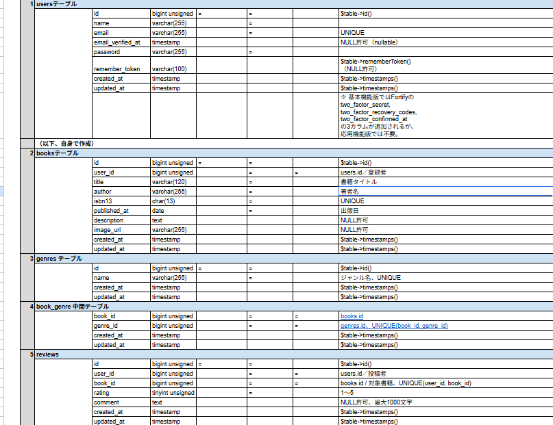
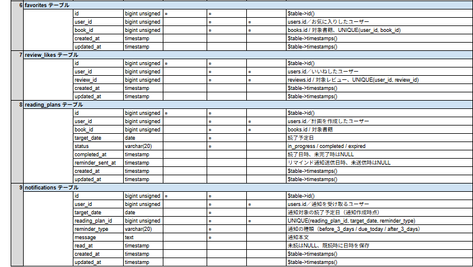
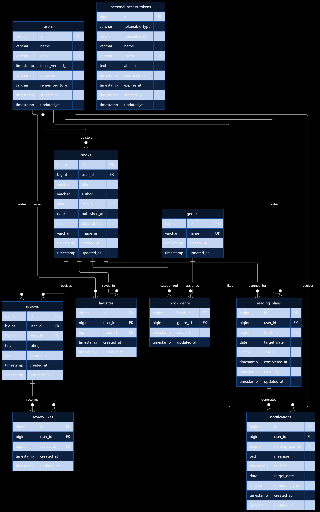

# Bookshelf（書籍管理・読書支援アプリ）

Bookshelfは、書籍の登録・検索・レビュー投稿に加え、読書計画や読書レポートによって日々の読書活動をサポートするWebアプリケーションです。

書籍の検索や管理だけでなく、読みたい本の記録、レビューによる評価の共有、読書目標の管理まで一つのアプリケーションで行えるようにしています。

## 環境構築

### 使用する環境

- Docker Desktop
- Docker Compose
- Laravel Sail
- PHP 8.5
- MySQL 8.4
- Node.js / npm

Windows環境ではWSL2の利用を想定しています。以下のコマンドはWSL2のターミナルから実行してください。環境構築を始める前にDocker Desktopを起動してください。

本手順は、新しくクローンし、未初期化のMySQLデータベースを使用する場合を想定しています。

### 1. リポジトリをクローン

```bash
git clone https://github.com/yutaka-fujise/bookshelf-app.git
cd bookshelf-app
```

HTTPS形式のためGitHubのSSHキー設定は不要です。以降、特に指定がない限り `bookshelf-app` ディレクトリ内で実行します。

### 2. Composerの依存パッケージをインストール

Laravel SailのDockerfileは `vendor` ディレクトリ内にあるため、初回起動前にComposerの依存パッケージをインストールします。

ホスト環境にPHPとComposerがある場合：

```bash
composer install
```

ホスト環境にPHPやComposerがない場合：

```bash
docker run --rm -u "$(id -u):$(id -g)" -v "$(pwd):/app" -w /app composer:2 install --ignore-platform-reqs
```

後者はDocker上のComposerを利用します。`--ignore-platform-reqs` はインストール時のPHPバージョンや拡張機能の要件チェックを省略するオプションです。アプリケーションは後続のLaravel Sail環境で実行します。

### 3. .envファイルを作成

```bash
cp .env.example .env
```

`.env` に以下の設定が含まれることを確認し、必要に応じて編集してください。

```dotenv
APP_NAME=Bookshelf
APP_URL=http://localhost

DB_CONNECTION=mysql
DB_HOST=mysql
DB_PORT=3306
DB_DATABASE=bookshelf
DB_USERNAME=sail
DB_PASSWORD=password

GOOGLE_BOOKS_API_KEY=
```

**データベース名・ユーザー名・パスワードはMySQLコンテナの初回起動前に設定してください。** MySQLの初回起動時にこれらの設定に基づいてデータベースとユーザーが初期化されます。

Google Books APIを利用する場合は、`GOOGLE_BOOKS_API_KEY` に自身で取得したAPIキーを設定してください。APIキーはGitHubに公開しないでください。

### 4. Dockerコンテナをビルド・起動

```bash
./vendor/bin/sail up -d --build
```

初回起動時はDockerイメージのビルドとMySQLの初期化が行われます。次のコマンドで状態を確認します。

```bash
./vendor/bin/sail ps
```

**MySQLコンテナのSTATUSが `healthy` になってから次の手順に進んでください。** `Up ... (health: starting)` の場合は、少し時間をおいて再確認してください。初期化が終わる前にマイグレーションすると、`SQLSTATE[HY000] [2002] Connection refused` が発生する場合があります。

**既存のDocker環境を再利用する場合の注意：** 同じプロジェクト名で以前に作成したMySQL永続ボリュームが再利用される場合があります。リポジトリの再クローンやフォルダ削除ではDockerボリュームは削除されません。既存のDB設定と `.env` が一致しない場合は接続・権限エラーが発生することがあります。まず次のコマンドで確認してください。

```bash
docker volume ls
```

通常のプロジェクト名ではMySQLボリューム名は `bookshelf-app_sail-mysql` です。**ボリューム削除は保存済みDBデータを消去します。通常の環境構築では削除しないでください。** データを破棄して初期化する場合の手順は後述します。

### 5. アプリケーションキーを生成

```bash
./vendor/bin/sail artisan key:generate
```

### 6. マイグレーション・シーディングを実行

**MySQLが `healthy` であることを確認してから、未初期化のDBに対して初回のみ実行してください。**

```bash
./vendor/bin/sail artisan migrate --seed
```

ユーザー・ジャンル・書籍・レビュー・お気に入り・レビューへのいいね・読書計画などの初期データが登録されます。

**注意：** すでにシーディング済みのDBに `migrate --seed` を繰り返すと、レビューなどのUNIQUE制約によって `1062 Duplicate entry` が発生する場合があります。通常の再起動ではシーディングを再実行しないでください。既存データを保持したまま追加のマイグレーションだけを適用する場合：

```bash
./vendor/bin/sail artisan migrate
```

### 7. Node.jsパッケージをインストール

```bash
./vendor/bin/sail npm install
```

依存パッケージに関する脆弱性警告が表示される場合があります。警告の内容とインストールの成否を区別し、コマンドが正常終了したことを確認してください。

### 8. フロントエンドのビルド

```bash
./vendor/bin/sail npm run build
```

画面表示に必要なCSS・JavaScriptが生成されます。ビルド前にアクセスすると `Vite manifest not found` と表示される場合があります。

開発中にVite開発サーバーを利用する場合：

```bash
./vendor/bin/sail npm run dev
```

### 9. アプリケーションにアクセス

ブラウザで [http://localhost](http://localhost) にアクセスしてください。書籍一覧画面に初期データの書籍が表示されれば、基本的な環境構築は完了です。ログインには後述のサンプルアカウントを利用できます。

### 10. 2回目以降の起動

通常の起動：

```bash
./vendor/bin/sail up -d
```

停止：

```bash
./vendor/bin/sail down
```

通常、`sail down` ではMySQLの永続ボリュームは削除されません。起動・停止のたびにマイグレーションやシーディングを再実行する必要はありません。

### トラブルシューティング

#### MySQLへの接続が拒否される（2002）

`SQLSTATE[HY000] [2002] Connection refused` の場合、MySQLコンテナがまだ準備中の可能性があります。

```bash
./vendor/bin/sail ps
```

MySQLが `healthy` になってから再試行してください。解消しない場合はログを確認します。

```bash
./vendor/bin/sail logs mysql
```

#### データベースへのアクセス権限エラー（1044）

`SQLSTATE[HY000] [1044] Access denied for user 'sail'@'%' to database 'bookshelf'` の場合、`.env` とMySQL内のDB名・ユーザー権限が不一致の可能性があります。`DB_DATABASE`、`DB_USERNAME`、`DB_PASSWORD` と既存ボリュームを確認してください。

```bash
docker volume ls
```

既存データが必要ならボリュームを削除せず、DBと権限設定を確認してください。

#### 既存MySQLデータを破棄して初期化し直す場合

**注意：以下の操作は対象DB内の保存済みデータをすべて削除します。バックアップがない場合、復元できません。不要な検証用DBであることを確認した場合のみ実行してください。**

```bash
./vendor/bin/sail down
docker volume ls
```

対象が `bookshelf-app_sail-mysql` であることを確認し、そのデータを破棄してよい場合だけ次を実行します。

```bash
docker volume rm bookshelf-app_sail-mysql
docker volume ls
```

`.env` のDB設定を確認したあと、コンテナを起動します。

```bash
./vendor/bin/sail up -d --build
./vendor/bin/sail ps
```

MySQLが `healthy` になったら、**新しいDBに対して一度だけ**実行します。

```bash
./vendor/bin/sail artisan migrate --seed
```

#### シーディングで重複エラー（1062）

`SQLSTATE[23000]: Integrity constraint violation: 1062 Duplicate entry` は既存データの重複登録による可能性があります。`INFO Nothing to migrate.` はマイグレーション完了済みを表しますが、シーディング完了の保証ではありません。

マイグレーションの状態は次のコマンドで確認できます。

```bash
./vendor/bin/sail artisan migrate:status
```

既存データがありアプリケーションが正常に動くなら、シーディングを繰り返す必要はありません。

#### Viteのmanifestエラー

`Vite manifest not found` が表示される場合は、フロントエンドをビルドしてください。

```bash
./vendor/bin/sail npm install
./vendor/bin/sail npm run build
```

完了後、ブラウザを再読み込みしてください。

## 使用技術（実行環境）

| 技術 | バージョン・用途 |
|---|---|
| PHP | 8.5 |
| Laravel | 10.x |
| MySQL | 8.4 |
| Docker / Docker Compose | 開発環境 |
| Laravel Sail | Laravelのコンテナ環境 |
| Laravel Fortify | ユーザー認証 |
| Laravel Sanctum | APIトークン認証 |
| Tailwind CSS | 3.x |
| Alpine.js | 3.x |
| Vite | 5.x |
| PHPUnit | 10.x |

## 機能一覧

### ユーザー認証

- ユーザー登録
- ログイン / ログアウト
- 認証状態に応じたアクセス制御
- 日本語のバリデーションメッセージ

### 書籍管理

- 書籍一覧表示
- 書籍詳細表示
- 書籍登録
- 書籍情報の編集
- 書籍削除
- 書籍所有者のみ編集・削除可能
- ISBN-13の重複登録防止
- 書籍への複数ジャンル設定

### 書籍検索・絞り込み・並べ替え

- 書籍タイトル・著者によるキーワード検索
- ジャンルによる絞り込み
- キーワードとジャンルの組み合わせ検索
- 新着順・古い順・評価順・タイトル順の並べ替え
- ページネーション
- 検索条件の保持・リセット

### ISBNによる書籍情報取得

- ISBNから書籍情報を検索
- Google Books APIとの連携
- Google Booksで取得できない場合はOpen Library APIを利用
- タイトル・著者・説明・出版日・画像などの取得
- 取得した情報を登録フォームに反映
- 取得できなかった項目は手動で入力可能

**注意事項：** ISBN検索後、著者名が自動入力されず、著者が不明な場合は、著者欄に「不明」と入力して登録してください。

### ジャンル管理

- ジャンル一覧・詳細表示
- ジャンル登録
- ジャンル名の編集
- ジャンル削除
- 同名ジャンルの重複登録防止
- 書籍が関連付けられているジャンルの削除制限

### レビュー機能

- 書籍へのレビュー投稿
- 5段階評価
- コメント入力
- レビューの編集・削除
- レビュー所有者のみ編集・削除可能
- 同一ユーザーによる同一書籍への重複レビュー防止
- レビューへのいいね・いいね解除

### お気に入り機能

- 書籍のお気に入り登録・解除
- 自分のお気に入り書籍一覧の表示
- お気に入りの重複登録防止

### ランキング機能

- 書籍の平均評価に基づくランキング
- 評価の高い書籍を上位10件表示
- レビューのない書籍はランキングから除外

### 読書計画

- 読書計画の登録
- 読書計画の一覧・詳細確認
- 読書期限の変更
- 読書完了への変更
- 読書計画の削除
- 進行中・期限切れ・完了の状態管理
- 状態別の絞り込み
- 同一書籍の進行中の読書計画の重複防止
- 完了済み・期限切れの読書計画がある場合の再登録
- 期限切れの読書計画の再編集

### リマインダー・通知

- 読書期限の3日前のリマインダー
- 読書期限当日のリマインダー
- 読書期限の3日後のリマインダー
- 通知一覧表示
- 通知の既読処理
- 重複通知の防止
- 自分の通知のみ閲覧・操作可能

### 読書レポート

- 自分の読書データの集計
- 読書状況の統計表示
- 評価分布の表示
- 高評価書籍の上位5件表示
- ジャンル別評価の上位5件表示

### REST API

- 書籍一覧取得
- 書籍詳細取得
- 書籍登録
- 書籍更新
- 書籍削除
- キーワード検索・ジャンル絞り込み
- ページネーション
- Laravel Sanctumによる書き込みAPIの認証
- Policyによる書籍所有者の認可

## API仕様

APIのベースURL：

```text
http://localhost/api/v1
```

| メソッド | エンドポイント | 内容 | 認証 |
|---|---|---|---|
| GET | `/books` | 書籍一覧 | 不要 |
| GET | `/books/{book}` | 書籍詳細 | 不要 |
| POST | `/books` | 書籍登録 | Sanctum |
| PUT | `/books/{book}` | 書籍更新 | Sanctum |
| DELETE | `/books/{book}` | 書籍削除 | Sanctum |

一覧取得APIでは、次のクエリパラメータが使用できます。

| パラメータ | 説明 |
|---|---|
| `keyword` | タイトル・著者による検索 |
| `genre_id` | ジャンルIDによる絞り込み |
| `per_page` | 1ページの表示件数（1〜100件） |
| `page` | 取得するページ番号 |

書き込み系APIでは、Bearerトークンによる認証が必要です。

```text
Authorization: Bearer {token}
```

書籍の更新・削除は、その書籍を登録したユーザーだけが実行できます。

## サンプルアカウント

シーディングを実行すると、次の開発用ユーザーが作成されます。

| ユーザー名 | メールアドレス |
|---|---|
| 山田太郎 | yamada@example.com |
| 鈴木花子 | suzuki@example.com |
| 田中一郎 | tanaka@example.com |
| 佐藤美咲 | sato@example.com |
| 高橋健太 | takahashi@example.com |

**共通パスワード：** `password`

これらは動作確認用のダミーアカウントです。

## テスト

Laravel Sailを使用し、次のコマンドでテストを実行できます。

```bash
./vendor/bin/sail artisan test
```

### テスト用データベース

テストでは、通常のアプリケーション用データベースとは別の `testing` データベースを使用します。

`phpunit.xml` で以下の設定を行っています。

```xml
<env name="APP_ENV" value="testing"/>
<env name="DB_DATABASE" value="testing"/>
```

### 主なテスト内容

- ユーザー登録・ログイン・ログアウト
- 書籍CRUD・入力値のバリデーション
- 書籍所有者によるアクセス制御
- ISBN検索と外部APIのフォールバック
- 書籍の検索・絞り込み・並べ替え
- ジャンル管理
- レビュー投稿・更新・削除
- レビューへのいいね
- お気に入り
- ランキング
- 読書計画の登録・更新・削除・完了
- 読書計画の期限切れ判定
- リマインダー通知
- 読書レポート
- Sanctum認証を使用したAPI
- モデルの属性・データベース制約

2026年10月24日時点の全体テスト実行結果：

```text
Tests:    3 deprecated, 251 passed (720 assertions)
Duration: 27.30s
```

非推奨警告はPHP 8.5などの依存環境に関連するもので、テスト失敗はありません。

## テーブル設計

### 主なテーブル

| テーブル名 | 内容 |
|---|---|
| users | ユーザー |
| books | 書籍 |
| genres | ジャンル |
| book_genre | 書籍とジャンルの関連 |
| reviews | 書籍レビュー |
| review_likes | レビューへのいいね |
| favorites | お気に入り |
| reading_plans | 読書計画 |
| notifications | 通知 |
| personal_access_tokens | APIトークン |

Laravel標準の `password_reset_tokens`・`failed_jobs` テーブルも使用しています。

### テーブル設計①



### テーブル設計②



### ER図



## URL

| 項目 | URL |
|---|---|
| アプリケーション | [http://localhost](http://localhost) |
| 書籍一覧 | [http://localhost/books](http://localhost/books) |
| 書籍ランキング | [http://localhost/ranking](http://localhost/ranking) |
| ログイン | [http://localhost/login](http://localhost/login) |
| ユーザー登録 | [http://localhost/register](http://localhost/register) |
| phpMyAdmin | [http://localhost:8080](http://localhost:8080) |
| 書籍API | [http://localhost/api/v1/books](http://localhost/api/v1/books) |

上記URLはデフォルトのポート設定を使用した場合のものです。

## 補足

- ユーザー認証にはLaravel Fortifyを使用しています。
- API認証にはLaravel Sanctumを使用しています。
- 書籍の編集・削除にはLaravel Policyを使用し、所有者以外の操作を制限しています。
- ISBN検索にはGoogle Books APIとOpen Library APIを使用しています。
- 読書計画のリマインダーは、期限の3日前・当日・3日後を対象としています。
- Docker環境下での再現性を重視し、Laravel Sailを使用しています。

## 工夫した点

### ISBN検索のフォールバック設計

書籍登録時の入力負担を軽減するため、ISBNを使用した書籍情報の自動取得機能を実装しました。

Google Books APIで書籍情報を取得できない場合には、Open Library APIを利用する構成としています。

また、取得できない項目については手動入力を可能にし、外部APIのデータ不足によって書籍登録ができなくなることを防いでいます。

### Policyによる認可処理の共通化

書籍の編集・削除では `BookPolicy` を使用しています。

Web画面とREST APIで共通の所有者判定を利用することで、認可ルールの重複を減らし、一貫したアクセス制御を行っています。

所有者以外による更新・削除操作はHTTP 403で拒否する設計です。

### 読書計画の状態管理

読書計画に `in_progress`・`expired`・`completed` の状態を設けています。

同一ユーザー・同一書籍について進行中の計画が重複しないよう制御しながら、過去に完了した計画や期限切れになった計画の履歴は保持できる構成としています。

また、期限切れの計画は期限を変更することで再び進行中に戻せるようにし、実際の読書状況に合わせて柔軟に管理できるようにしています。

### リマインダー通知の重複防止

読書期限の3日前・当日・3日後を対象に通知を生成する機能を実装しました。

同じ対象に対する通知の重複生成を防ぎ、通知一覧から既読管理できる構成としています。

### 書籍・ジャンル・レビューのデータ整合性

書籍の登録・更新処理では、関連するジャンルの更新をトランザクション内で行っています。

また、ISBNやジャンル名の重複登録をバリデーションで防止し、関連書籍が存在するジャンルの削除を制限することで、データ整合性を保つ設計としています。

### テストの充実

PHPUnitを使用して、正常系だけでなく異常系のテストも実装しています。

特に、他ユーザーによる不正な更新・削除、入力値の不備、重複登録、読書計画の状態遷移、外部API取得失敗時の処理などを重点的に検証しました。
